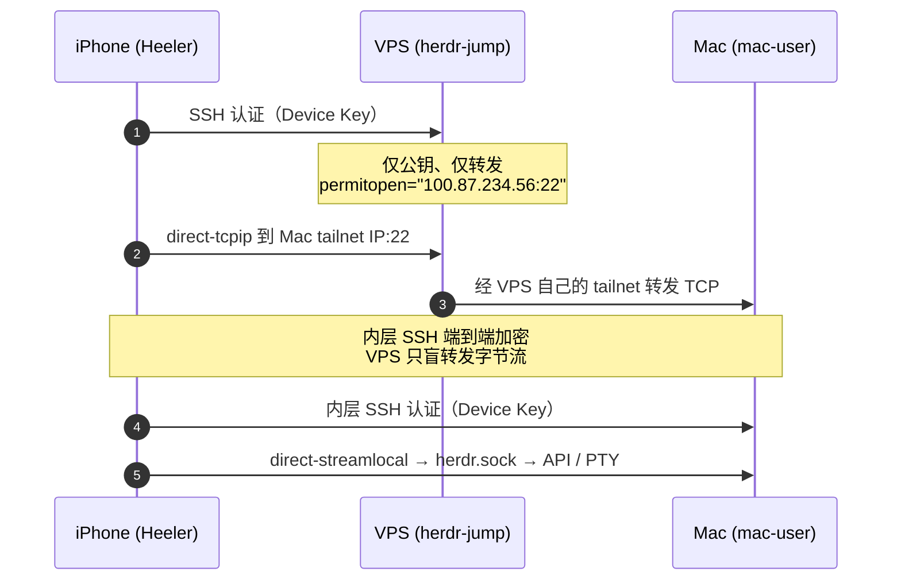

# 只带一台 iPhone 出门：用 Heeler 远程接管 Mac 上的 AI Agent

> 我的 coding agent（Claude Code、Pi 等）都跑在 Mac 上，由 [herdr](https://herdr.dev) 统一管理。这篇文章记录怎么用 [Heeler](https://github.com/ZingerLittleBee/Heeler)（herdr 的 iOS 客户端）加 [Tailscale](https://tailscale.com) 组网，做到只带一台 iPhone 出门，也能看哪个 agent 需要我、回复它、甚至接管它的终端。
>
> 绝大多数人只需要**方式 A：Tailscale 直连**；如果你和我一样给 iPhone 开着代理软件，再看**方式 B：加一台跳板机**。

<!-- more -->

## 本文使用的资源示例

为了阅读流畅，下面统一用这些示例值，实际使用时替换成你自己的：

| 资源类型 | 示例值 | 说明 |
|---------|--------|------|
| Mac 登录账号 | `mac-user` | 跑 herdr 的 macOS 账号 |
| Mac Tailscale IP | `100.87.234.56` | Mac 在 tailnet 里的地址 |
| 手机设备名 | `heeler` | Heeler 在 tailnet 里的名字 |
| VPS 公网 IP | `203.0.113.50` | 仅方式 B 需要 |
| VPS Tailscale IP | `100.87.234.57` | 仅方式 B 需要 |
| 跳板账号 | `herdr-jump` | 仅方式 B 需要 |

## 背景与架构

先说清几个组件：**herdr** 是跑在 Mac 上的 agent 终端运行时，负责管理每台机器上的 coding agent；**Heeler** 是它的 iOS 原生客户端，通过 SSH 连到 herdr，把 agent 列表、终端、聊天搬进手机；**Tailscale** 是基于 WireGuard 的组网工具，让 Mac 和 iPhone 跨 NAT 互相访问。

### 两种连接方式

Heeler 连到 Mac 有两条路，按需选择。

**方式 A：Tailscale 直连。** 这是大多数人的场景——iPhone 上没装代理软件。手机直接用 Heeler 内嵌的 Tailscale 连到 Mac 的 tailnet IP，不需要额外机器，配置完就能用。如果你没给 iPhone 装 Shadowrocket、Quantumult X 这类代理 App，选它就行。

**方式 B：跳板机。** 如果你和我一样给 iPhone 开着代理软件，方式 A 会失效（原因见后文），这时需要一台有固定公网 IP 的 VPS 当跳板机：手机连 VPS 的公网 IP，VPS 再在 tailnet 里转发到 Mac。代价是多一台机器，好处是能和代理共存。

{ width="640" loading="lazy" }

## 准备工作

### Mac 端

安装并启动 [herdr](https://herdr.dev/docs/install/)，然后打开**系统设置 → 通用 → 共享 → 远程登录**，允许你的账号。顺手记一下登录名和主机指纹，后面 Heeler 首次连接要核对：

```bash
id -un
ssh-keygen -lf /etc/ssh/ssh_host_ed25519_key.pub
```

### iPhone 端：安装 Heeler

Heeler 用了推送通知、App Group、Widget 扩展，这些必须付费开发者账号才能签名，个人免费账号编译不通过，所以别折腾源码编译，直接装官方构建：

- **TestFlight（测试版）**：`https://testflight.apple.com/join/aXSxRn4r`
- **App Store（正式版）**：搜索 `Heeler for herdr`

装好后长这样，依次是 Agent 控制台、实时终端、聊天：

{ width="220" loading="lazy" }
{ width="220" loading="lazy" }
{ width="220" loading="lazy" }

> 截图来自 [Heeler 官方仓库](https://github.com/ZingerLittleBee/Heeler)（静态图）。想录动态演示的话，可以在 iOS 模拟器里跑起来后用 `xcrun simctl io booted recordVideo demo.mp4` 录一段。

然后在 **Hosts → Add Host** 里选 **Device Key**，复制 `authorized_keys` 那一行备用。

### VPS 端（仅方式 B 需要）

一台有固定公网 IP、能 root 登录的 Linux 服务器，本文以 Ubuntu 22.04 为例。方式 A 用不到它，可以跳过。

## Tailscale 组网

无论哪种方式，都要先把 Mac 和 iPhone 拉进同一个 tailnet（方式 B 再加 VPS）。

### 各设备登录

Mac 上安装并登录 Tailscale：

```bash
brew install tailscale && sudo tailscale up
```

iPhone 这边不用装 Tailscale App——Heeler 自带，在 **Settings → Overlay Networks → Add Network → Tailscale** 里添加，**Advanced 留空**，点 **Continue to Sign In** 用浏览器登录同一个账号即可。

### auth key 的坑

用 auth key 登录时，常见「之前登录成功过，后来突然失效」。先理解 auth key 的两个选项：**Reusable（可复用）** 和 **Ephemeral（临时）**，创建时都默认关闭。

auth key 本质是「首次注册」的一次性凭证，设备注册成功后靠自己的 node key 保持在线，不再需要它。问题就出在默认不勾 **Reusable**：一个 key 只能用一次，设备第一次注册就把它消耗掉了；之后如果设备状态丢失、要拿这个 key 重新注册，自然就报失效。它其实完全支持复用，只是创建时要手动把 Reusable 勾上。而 **Ephemeral** 勾选后设备一离线就会被 tailnet 自动删除，每次重连都要重新注册，和单次 key 叠加尤其容易翻车。

再加上 key 可能被手动吊销（后台 Keys 页）或过期，这就是「登录过又失效」的常见来源。结论：除非有明确理由，优先用浏览器登录，别用 auth key；非要用，就把 Reusable 打开、Ephemeral 关掉、有效期设长。

### 验证

在任一已入网设备上：

```bash
tailscale status
# 100.87.234.56  mac      you@   macOS  -
# 100.87.234.58  heeler   you@   iOS    -
```

设备都在、没有 `offline` 就是组网成功。

## 方式 A：手机直连 Mac（大多数人的场景）

不给 iPhone 开代理的话，做到这里就结束了，不需要跳板机。

### 授权 Device Key

把 Heeler 里复制的 Device Key 公钥加到 Mac：

```bash
mkdir -p ~/.ssh && chmod 700 ~/.ssh
echo 'ssh-ed25519 AAAA... heeler' >> ~/.ssh/authorized_keys
chmod 600 ~/.ssh/authorized_keys
```

如果用 herdr 的扫码配对（`herdr plugin action invoke heeler.pair`），这一步会自动完成。

### 添加 Mac Host

在 Heeler 里 **Hosts → Add Host**，路由里把 Network 选成上面配好的 Tailscale 网络，地址填 Mac 的 tailnet IP，其余如下：

| 字段 | 值 |
|------|-----|
| User | `mac-user` |
| Route · Network | Tailscale |
| Route · Address | `100.87.234.56` |
| Route · Port | `22` |
| Jump Host | 留空 |
| Authentication | Device Key |

### 验证

关 Wi-Fi、走 5G，Settings → Overlay Networks 里网络显示 **Connected**，然后回到 Host 跑检查、打开某个 Agent 的 **Attach** 能看到实时终端，就成了。

## 方式 B：开代理时用跳板机（可选）

### 为什么开代理就断

如果你给 iPhone 开了 Shadowrocket 这类 App，方式 A 会失效，根子在 macOS 和 iOS 对「代理」的实现完全不同。

Mac 上的 ClashX 只是改系统 HTTP/SOCKS 代理，只有走系统代理的 HTTP 类 App 受影响，Tailscale 的 WireGuard UDP 根本不经过它，所以两者能共存。而 iPhone 上的 Shadowrocket 是系统级 VPN（NEPacketTunnelProvider），在包层面接管手机所有流量——Heeler 内嵌 Tailscale 的控制面、DERP、WireGuard 全被塞进代理隧道，隧道又扛不住 UDP，于是断开。

{ width="600" loading="lazy" }

有时关掉代理后仍连不上，多半是 VPN 没真正断开（去「iOS 设置 → VPN」确认「未连接」），或者 Heeler 的 Tailscale 节点卡在失败态，到 Overlay Networks 里把该网络关一下再开即可。

### 解决思路：固定 IP 入口

既然手机端 Tailscale 和代理 VPN 天然冲突，那就别让手机端跑 Tailscale——让手机只连 VPS 的固定公网 IP（纯 TCP SSH），由 VPS 在 tailnet 里转发到 Mac。这条 TCP 连接可以用一条 DIRECT 规则从代理里放行，稳定可控。

### VPS 跳板机部署

先确认 VPS 已入网，且 Tailscale ACL 放行 `VPS → Mac:22`：

```bash
timeout 6 bash -c 'echo > /dev/tcp/100.87.234.56/22' && echo REACHABLE || echo UNREACHABLE
```

**Step 1：创建受限账号。**

```bash
adduser --disabled-password --gecos '' herdr-jump
install -d -m 700 -o herdr-jump -g herdr-jump /home/herdr-jump/.ssh
```

**Step 2：写入 Device Key，限制它只能转发到 Mac。** `restrict` 默认禁止转发，`port-forwarding` 重新放开，`permitopen` 再收窄到唯一目标：

```text
restrict,port-forwarding,permitopen="100.87.234.56:22" ssh-ed25519 AAAA... heeler
```

```bash
chown herdr-jump:herdr-jump /home/herdr-jump/.ssh/authorized_keys
chmod 600 /home/herdr-jump/.ssh/authorized_keys
```

**Step 3：用 sshd drop-in 加固账号。** 新建 `/etc/ssh/sshd_config.d/60-herdr-forwarding.conf`：

```sshconfig
Match User herdr-jump
    AuthenticationMethods publickey
    PubkeyAuthentication yes
    PasswordAuthentication no
    KbdInteractiveAuthentication no
    AllowTcpForwarding local
    AllowStreamLocalForwarding no
    PermitListen none
    PermitOpen 100.87.234.56:22
    GatewayPorts no
    PermitTTY no
    PermitTunnel no
    PermitUserRC no
    X11Forwarding no
    AllowAgentForwarding no
    MaxSessions 0

Match all
```

其中 `MaxSessions 0` 禁止 shell/登录会话，但仍允许端口转发。校验并重载：

```bash
/usr/sbin/sshd -t
systemctl reload ssh
```

**Step 4：端到端验证。** 整条链路的两次 SSH 握手是这样的：



用一把临时密钥做全链路验证：

```bash
ssh -i /tmp/testkey \
  -o "ProxyCommand=ssh -i /tmp/testkey -W %h:%p herdr-jump@203.0.113.50" \
  mac-user@100.87.234.56 'echo JUMP_OK; id -un'
```

### Heeler 与 Shadowrocket 配置

Heeler 里编辑 Mac Host 的路由，这次 Network 选 **Direct**，并填上 Jump Host：

| 字段 | 值 |
|------|-----|
| Route · Network | Direct |
| Route · Address | `100.87.234.56` |
| Route · Port | `22` |
| Route · Jump Host address | `203.0.113.50` |
| Route · Jump Host port | `22` |
| Route · Jump Host user | `herdr-jump` |
| Authentication | Device Key |

Shadowrocket 里加一条**最高优先级**的 DIRECT 规则，让手机连 VPS 的 SSH 直连不走代理：

```text
IP-CIDR,203.0.113.50/32,DIRECT
```

## 验证

不管走哪条路，最后都按这套清单确认：关 Wi-Fi、走 5G（方式 B 再开着代理），Heeler 里 Mac Host 的检查通过，能打开 Agent 的 **Attach** 看到实时终端，新建终端 `pwd` 打印出 Mac 上的目录。

## 故障排查

| 现象 | 排查方向 |
|------|---------|
| Tailscale 网络显示 offline | `tailscale status` 看 `heeler` 节点；Heeler 里该网络关一下再开，必要时浏览器重新登录 |
| 开代理就连不上（方式 A） | 这是预期冲突，改用方式 B，或临时关代理 |
| 关代理后仍连不上 | 确认 VPN 已断开（iOS 设置 → VPN → 未连接）；Heeler 节点卡失败态就先关再开 |
| 跳板拒绝 Device Key | 检查 `/home/herdr-jump/.ssh/authorized_keys` 的公钥与 `permitopen` |
| Jump 通了但 Mac 认证失败 | Device Key 是否也在 Mac 的 `~/.ssh/authorized_keys` |
| 走到 Mac 但 herdr 检查失败 | herdr 是否在跑、`AllowStreamLocalForwarding` 是否被禁 |

常用的诊断命令：

```bash
# VPS 上
tailscale status
sshd -T -C user=herdr-jump,host=localhost,addr=127.0.0.1 | grep -E 'permitopen|allowtcpforwarding|maxsessions'
/usr/sbin/sshd -t

# Mac 上
sudo sshd -T | grep -iE 'passwordauthentication|kbdinteractiveauthentication'
herdr plugin log list
```

## 安全加固

无论哪种方式，Mac 的 SSH 都是最终入口，建议关掉密码登录、只留 Device Key：

```bash
printf 'PasswordAuthentication no\nKbdInteractiveAuthentication no\nChallengeResponseAuthentication no\n' \
  | sudo tee /etc/ssh/sshd_config.d/10-disable-password.conf
sudo launchctl kickstart -k system/com.openssh.sshd
sudo sshd -T | grep -iE 'passwordauthentication|kbdinteractiveauthentication'
# passwordauthentication no
# kbdinteractiveauthentication no
```

关掉后，能进 Mac 的只有持有 Device Key 私钥的设备，也就是你的 iPhone。

### 方式 B：跳板机自己也别留密码登录

方式 A 到此就结束了。方式 B 容易漏的是另一半：前面只给 `herdr-jump` 这个账号做了 `Match` 加固，**整台跳板机的 sshd 仍然默认开着密码登录**——`root` 或其它账号照样能被爆破。公网 VPS 每天被扫几十万次，这一步不能省。

先看现状再动手（很多云镜像，如 Ubuntu 的 cloud-init、DigitalOcean 的 droplet 镜像，已经自带 `PasswordAuthentication no`）：

```bash
sudo sshd -T | grep -iE 'passwordauthentication|kbdinteractiveauthentication|permitrootlogin'
# 全是 no / without-password 就跳过本节，否则继续
```

```bash
printf 'PasswordAuthentication no\nKbdInteractiveAuthentication no\nPermitRootLogin prohibit-password\n' \
  | sudo tee /etc/ssh/sshd_config.d/10-disable-password.conf
sudo /usr/sbin/sshd -t && sudo systemctl reload ssh
sudo sshd -T | grep -i passwordauth   # 复核，应是 passwordauthentication no
```

> 先在新开的窗口里用密钥把 `root` 登一遍，确认能进去再执行——否则 reload 之后自己就进不去了。真锁在外面还能靠云厂商的 VNC / 串口控制台救回来。

改完后跳板机只认公钥，`herdr-jump` 那层还有 `restrict,port-forwarding,permitopen` 的二次收窄，外网能尝试的入口就只剩「猜出私钥」这一条。

效果是能直接看到的：我这台跳板机近 24 小时被敲了 1300 多次 `preauth` 连接、`Invalid user` 318 次、fail2ban 自动 ban 掉 46 个 IP，而全部日志里 `Accepted password` 是 **0 条**——扫描器还在敲，只是密码通道压根不存在了。

方式 B 再多说一句：跳板机确实能碰到 Mac 的 22 端口，但内层 SSH 是端到端加密、Heeler 会校验 Mac 的 host key，所以 VPS 既看不到也改不了内容；它想「控制 Mac」只剩暴力猜密码这一条路，而密码登录已经被关掉了。即使 VPS 整个被攻破，攻击者也登录不了 Mac。

## 最佳实践

- Tailscale 控制台开 2FA；方式 B 时收紧 ACL，只放行 `VPS → Mac 的 tcp:22`，其余默认拒绝。
- 优先浏览器登录，少用 auth key；确需 auth key 就勾 Reusable、不勾 Ephemeral、设长有效期。
- 手机丢了要把 Device Key 公钥从 Mac 的 `~/.ssh/authorized_keys`（方式 B 还有 VPS 的 `/home/herdr-jump/.ssh/authorized_keys`）移除。
- 方式 B 的跳板机是一片公网 IP，`herdr-jump` 之外的所有账号（尤其 `root`）也要关密码登录、只留密钥。
- 方式 B 强依赖 Mac 的 tailnet IP，Mac 重新登录 Tailscale 导致 IP 变了，要同步更新 VPS 的 `permitopen` 和 Heeler 路由里的 Address。
- 想让 Agent 变 Blocked/Done 时收到推送，在 Mac 上装插件：`herdr plugin install ZingerLittleBee/Heeler --ref plugin --yes`。

## 附录：参考资源

| 类型 | 链接 |
|------|------|
| Heeler 仓库 | https://github.com/ZingerLittleBee/Heeler |
| herdr 官网 | https://herdr.dev |
| Tailscale 安装 | https://tailscale.com/download |
| Tailscale ACL 文档 | https://tailscale.com/kb/1018/acls |
